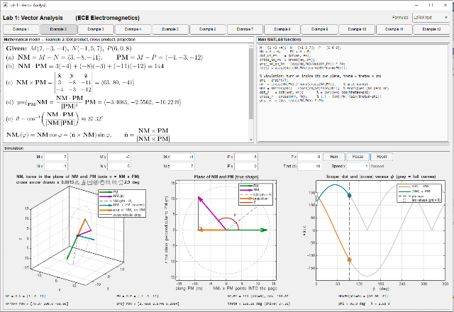
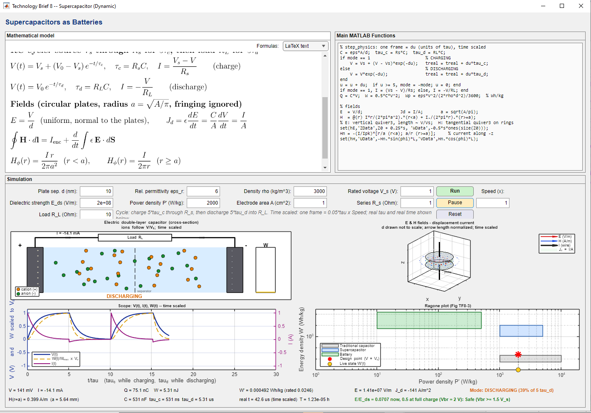

# S5 Proposed teaching illustrations

These interfaces were moved from the main manuscript to focus its ten pages on observed results. They are proposed design examples, not validated experimental or classroom outcomes.

## Vector-analysis interface

Illustrates dot products, cross products, projection and rotation. Example 2 input coordinates and source code were unavailable, so numerical claims cannot be verified from the screenshot and are omitted.

## Supercapacitor interface

Combines a lumped RC model, schematic ion motion, fields and a Ragone plot. It is not a validated microscopic transport model. Neither screenshot demonstrates learning gains. Students should define model assumptions and independent reference checks before relying on an interface.
